# lgtm

**Say LGTM and mean it.**

Fast GitHub PR review for your Mac: every file on one page, the noise folded away, and what a diff hides pointed out. It runs on your machine and signs in with your GitHub CLI login.

<picture>
  <source media="(prefers-color-scheme: dark)" srcset="docs/features/scene-app-dark.png">
  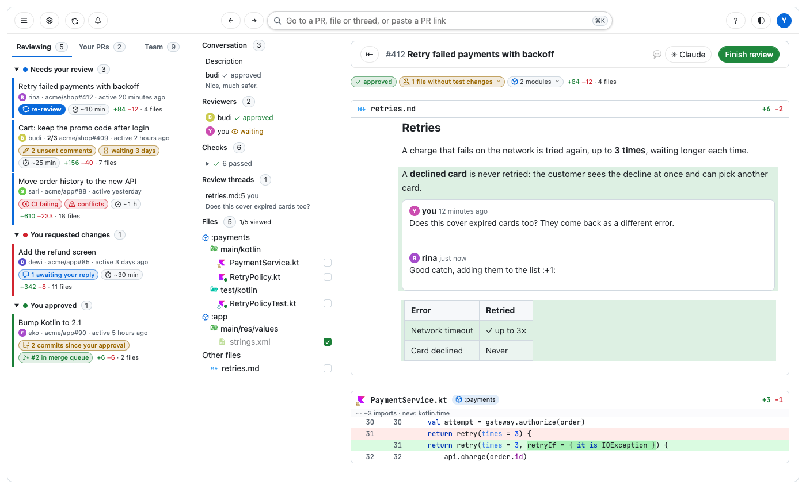
</picture>

## Install

macOS 13 or later, with Homebrew:

```bash
brew tap bukuwarung/lgtm https://github.com/bukuwarung/lgtm
brew install --cask bukuwarung/lgtm/lgtm
gh auth login   # once, if you haven't
```

`brew upgrade` updates it. Slack and Jira are optional; lgtm shows how to set them up on first launch.

## Highlights

- **One page per PR.** Every changed file in reading order, with imports, generated files, whitespace and bot chatter folded away.
- **It points things out.** Possible secrets, edited database migrations, text that won't be translated, a lockfile left behind, and more, each with a comment drafted for you.
- **Review mode.** Your PRs to review, one after another, with nothing else on screen.
- **An inbox.** Every thread and mention waiting on your reply, answered or put away without opening the PR.
- **The right reviewers.** Suggested by who wrote the code you changed and who's least busy, asked on GitHub and Slack in one click.
- **Your whole loop.** Merge box, Jira tickets moved on merge, Slack nudges, QA requests, and Claude Code linked to your PRs.

## Your queue

<picture>
  <source media="(prefers-color-scheme: dark)" srcset="docs/features/scene-queue-dark.png">
  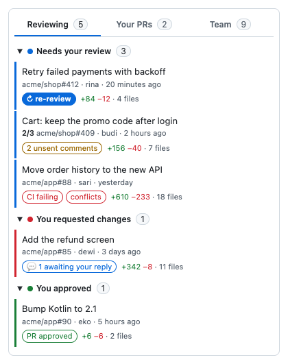
</picture>

- PRs to review, your own, and your team's, grouped by where they stand.
- Pills for what needs you: `CI failing`, `conflicts`, `↻ re-review`, replies waiting, commits since you approved. On your PRs, a pill's menu fixes what it names.
- Drafts you're a code owner of, before GitHub asks you.
- The bell keeps what needs you (review requested, replies, verdicts, mentions, CI, ready to merge, QA) until you open the PR; desktop notifications are a switch.
- Optional mutes: replies and mentions on PRs you've approved, and comments that open with 🤖 (agents posting from people's accounts).

## Inbox

- Review threads and PR comments that mention you, wherever they wait on your reply: open PRs, and ones merged lately.
- Each shows the code it's on and the earlier comments; reply, resolve, or mark it Done until someone writes again.
- On your own PR, commit a reviewer's suggested change from there.
- `j`/`k` move, `r` reply, `e` done, `x` resolve, `c` commit the suggestion, `o` open the PR.

## Review mode

<picture>
  <source media="(prefers-color-scheme: dark)" srcset="docs/features/scene-reviewmode-dark.png">
  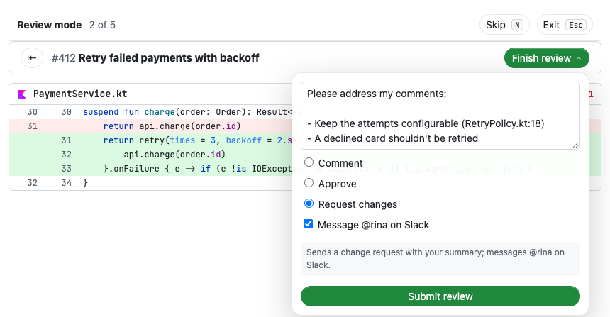
</picture>

- **▶ Review N PRs** (⇧⌘R) goes through what needs your review, longest-waiting first. Finishing one opens the next; `N` skips.
- At the end, what you did with each, to copy. With nothing to review, a practice run on your own PRs.

## Reading

<picture>
  <source media="(prefers-color-scheme: dark)" srcset="docs/features/scene-review-dark.png">
  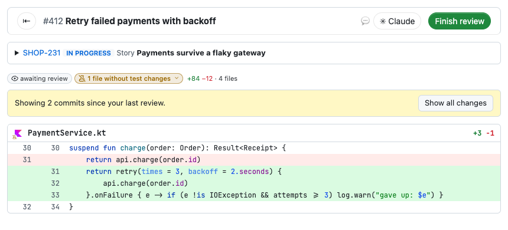
</picture>

- Files in reading order: specs and docs, build and config, models, the implementation (each test right below its class), other tests, then resources. Drag the steps into your own order; the index groups files by step, or as folders.
- Files grouped by module, with code changed but no test.
- Re-reviews show only what changed since your last one, and your threads say whether their lines moved.
- An index of comments, reviewers, checks (failed-job logs, and whether `main` fails them too) and files; big PRs get a review plan. It can start hidden on PRs waiting for your review.
- Side-by-side or unified, centred or full width, in your pick of themes and fonts.
- Android `strings.xml` as texts, with the other languages checked.

## Checks

lgtm reads the diff for what's easy to miss, and says so in a pill with a comment drafted for you. Each one can be switched off in Settings.

- **Any repo:** possible secrets, dependency changes (major jumps marked), binaries that belong in Git LFS, code changed without tests.
- **Android:** UI text not in `strings.xml`, Room tables changed without a version bump, what a manifest change means, new lint suppressions.
- **Java backend:** Flyway migrations edited or out of order, JPA entities changed with no migration, `@Transactional` on a private method.
- **Web:** a lockfile not updated, `.only` and `debugger` left in, raw HTML (`v-html`, `dangerouslySetInnerHTML`), checks switched off.
- On your own PR, lgtm shows what it found before you ask anyone to review.

## Specs and code

<picture>
  <source media="(prefers-color-scheme: dark)" srcset="docs/features/scene-specs-dark.png">
  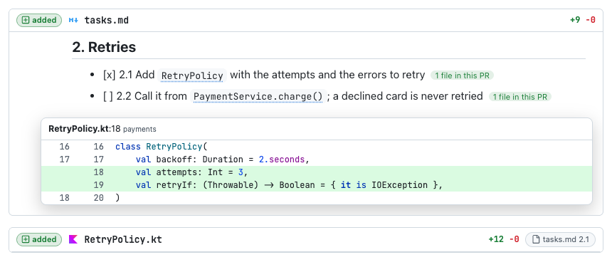
</picture>

- In a spec, a file, class or function the PR changes links to it, with a preview on hover; each changed file links back.
- `g` jumps between the specs and the code.

## Less to read

On by default, each with a switch and a preview in Settings:

- **Since your last review:** re-reviews show only what's new.
- **Fold imports**, naming only new libraries.
- **Generated, moved and deleted files** wait behind one row each.
- **Moved code** dimmed, with where it came from.
- **Changed words** highlighted inside a line.
- **Whitespace** ignored (`w`).
- **Markdown and doc comments** rendered (KDoc, Javadoc, JSDoc), still commentable line by line.
- **Images** as pictures, Android vector drawables too.
- **Bot comments** from CI and AI reviewers folded.

<details><summary>See each one, off and on</summary>

<picture>
  <source media="(prefers-color-scheme: dark)" srcset="docs/features/sinceFirst-dark.png">
  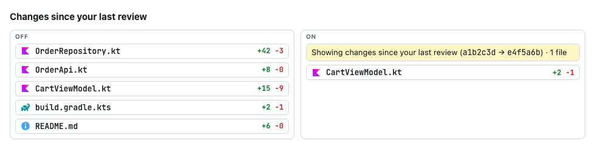
</picture>

<picture>
  <source media="(prefers-color-scheme: dark)" srcset="docs/features/foldImports-dark.png">
  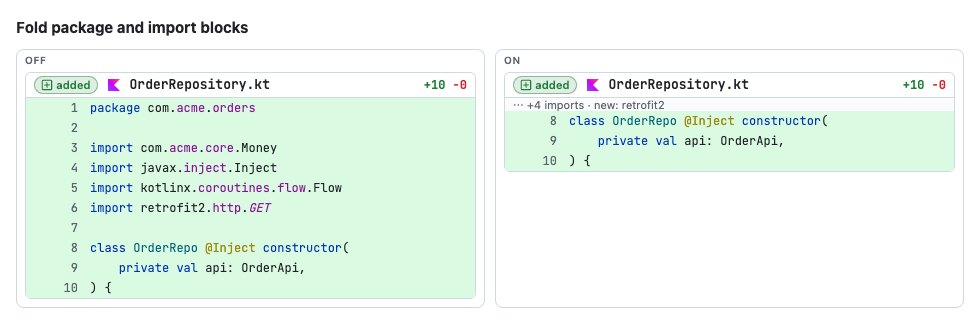
</picture>

<picture>
  <source media="(prefers-color-scheme: dark)" srcset="docs/features/hideGenerated-dark.png">
  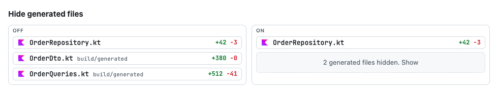
</picture>

<picture>
  <source media="(prefers-color-scheme: dark)" srcset="docs/features/hideNoDiff-dark.png">
  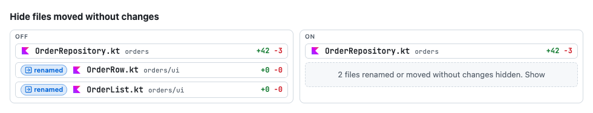
</picture>

<picture>
  <source media="(prefers-color-scheme: dark)" srcset="docs/features/collapseDeleted-dark.png">
  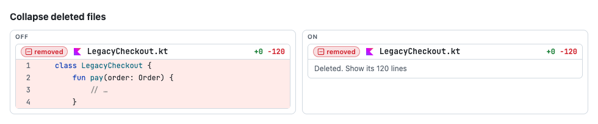
</picture>

<picture>
  <source media="(prefers-color-scheme: dark)" srcset="docs/features/dimMoved-dark.png">
  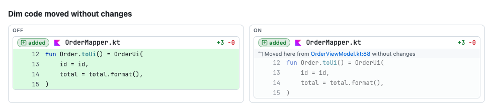
</picture>

<picture>
  <source media="(prefers-color-scheme: dark)" srcset="docs/features/wordDiff-dark.png">
  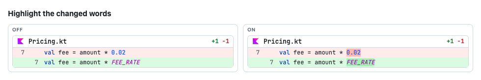
</picture>

<picture>
  <source media="(prefers-color-scheme: dark)" srcset="docs/features/ignoreWs-dark.png">
  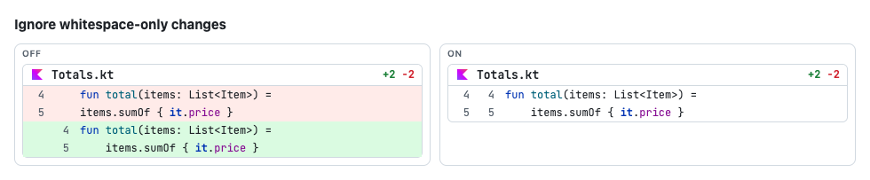
</picture>

<picture>
  <source media="(prefers-color-scheme: dark)" srcset="docs/features/richMarkdown-dark.png">
  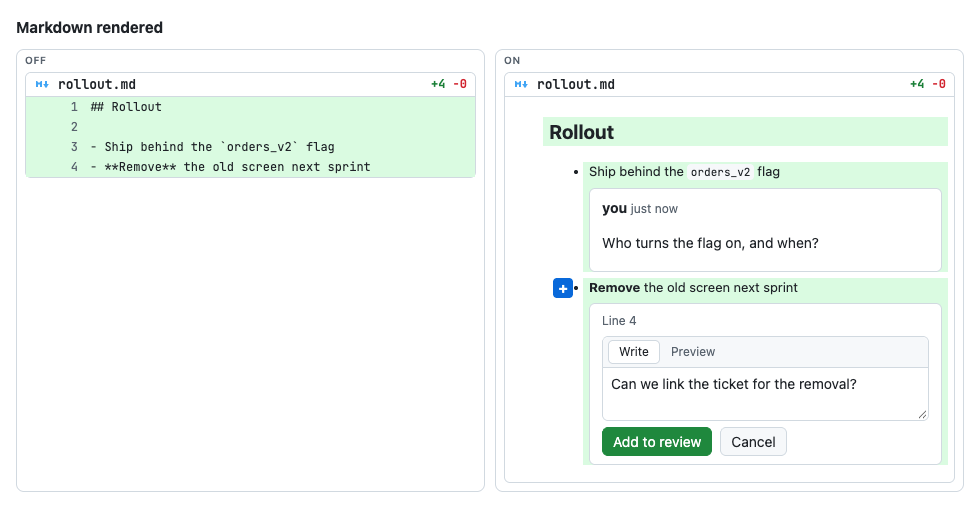
</picture>

<picture>
  <source media="(prefers-color-scheme: dark)" srcset="docs/features/renderDocs-dark.png">
  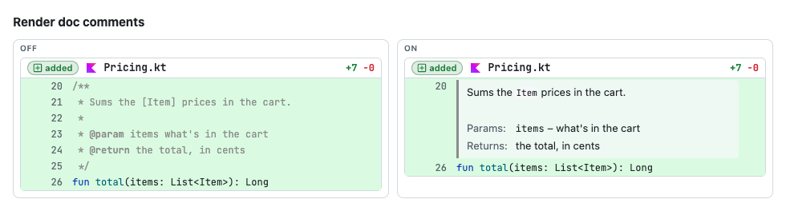
</picture>

<picture>
  <source media="(prefers-color-scheme: dark)" srcset="docs/features/previewImages-dark.png">
  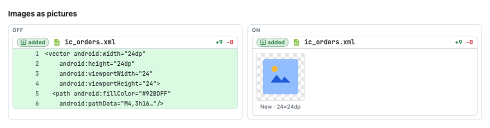
</picture>

<picture>
  <source media="(prefers-color-scheme: dark)" srcset="docs/features/foldBots-dark.png">
  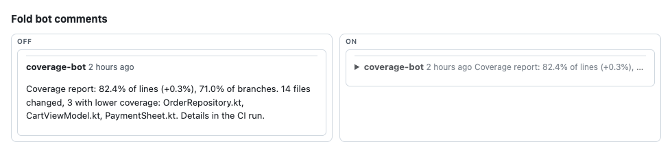
</picture>
</details>

## Commenting

<picture>
  <source media="(prefers-color-scheme: dark)" srcset="docs/features/scene-comment-dark.png">
  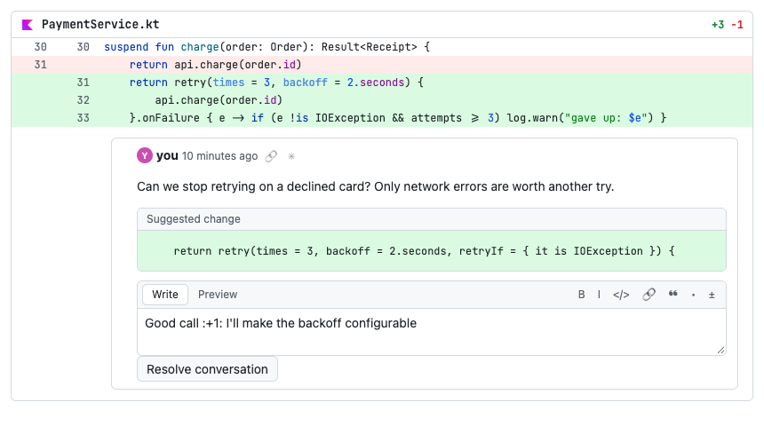
</picture>

- Line, range and file comments, with preview, `@mention`, emoji, saved replies (`/`) and suggested changes.
- Drafts survive reloads, move with new commits, and go out as one review; you see what GitHub and Slack will get first.

## Your PRs

<picture>
  <source media="(prefers-color-scheme: dark)" srcset="docs/features/scene-merge-dark.png">
  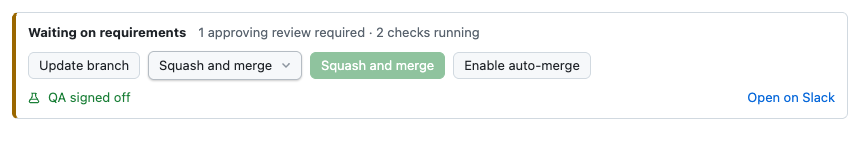
</picture>

- Reviewers suggested by who wrote the code and who's free (and who's away on Slack); one click asks on GitHub and Slack.
- Commit suggested changes, rerun failed jobs, and merge from a box that says what's blocking.
- Merging moves the Jira ticket on; a PR waiting a day can nudge its reviewers on Slack.
- **Ask QA** posts your QA request to the QA channel on Slack, filled in from the PR and yours to edit first. When QA replies, the PR, the list and the merge box say whether they signed off or raised an issue.

## Claude Code

<picture>
  <source media="(prefers-color-scheme: dark)" srcset="docs/features/scene-claude-dark.png">
  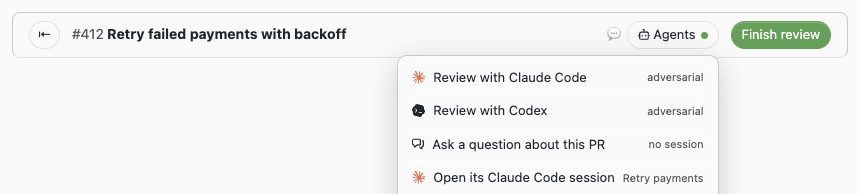
</picture>

- ✳ Claude opens a PR's Claude Code session, or starts one with the PR in the prompt; you see whether it's working or waiting for you. Its menu also asks a question about the PR, no session needed.
- Claude sends PRs here for review, and gets your review back to act on.

## Themes

<picture>
  <source media="(prefers-color-scheme: dark)" srcset="docs/features/scene-themes-dark.png">
  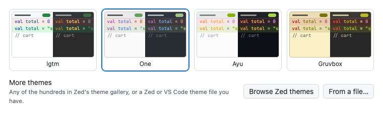
</picture>

- Whole-app colour themes, light and dark: lgtm's own, One, Ayu, Gruvbox, and hundreds from Zed and VS Code.

## On your Mac

- A menu bar item and Dock badge with what needs your review.
- `lgtm://` links, and an offer to open a PR link you copy.
- Several GitHub accounts, Launch at login, and updates through Homebrew.

## More

[Keyboard shortcuts, install notes and setup](docs/reference.md) · [Build and release](docs/develop.md)

## License

[MIT](LICENSE). The markdown themes are adapted from [markdown.style](https://markdown.style) (Apache 2.0); the icons are GitHub's [Octicons](https://github.com/primer/octicons) (MIT, © GitHub Inc.) and, for file types, [Material Icon Theme](https://github.com/material-extensions/vscode-material-icon-theme) (MIT, © Material Extensions). The code colour themes take their palettes from One (Atom), GitHub Primer, VS Code, Dracula, Solarized, Gruvbox, Catppuccin, Tokyo Night and Nord, all MIT. Every license, with the npm packages and Rust crates lgtm includes, is in [THIRD-PARTY-NOTICES.md](THIRD-PARTY-NOTICES.md).
