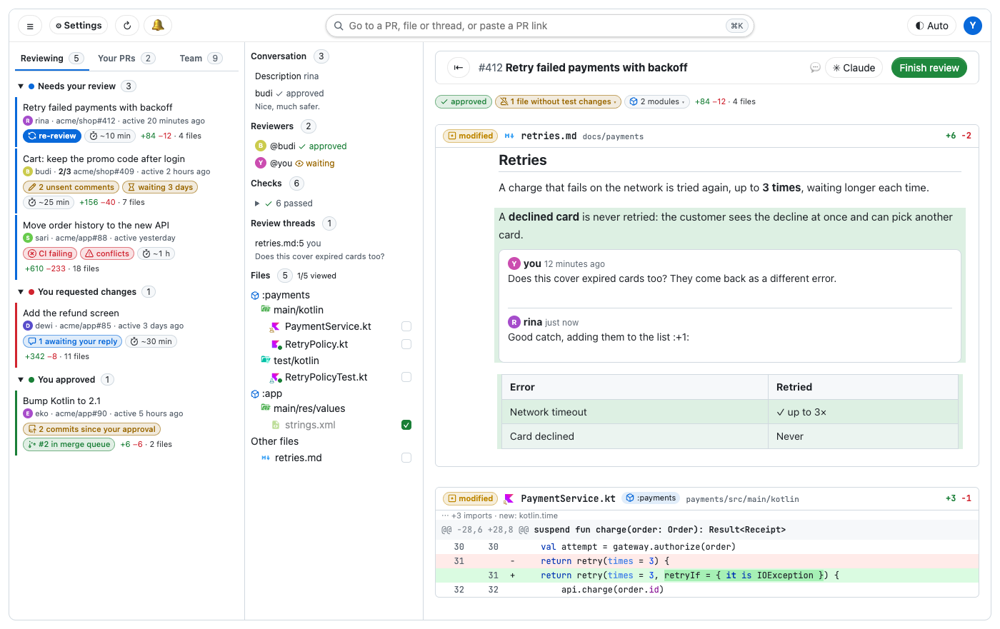

# lgtm

Fast GitHub PR review as a Mac app: every file on one page, less noise. It runs on your machine and signs in with your GitHub CLI login.

<picture>
  <source media="(prefers-color-scheme: dark)" srcset="docs/features/scene-app-dark.png">
  
</picture>

## Install

macOS 13 or later, with Homebrew:

```bash
brew tap bukuwarung/lgtm https://github.com/bukuwarung/lgtm
brew install --cask bukuwarung/lgtm/lgtm
gh auth login   # once, if you haven't
```

`brew upgrade` updates it. Slack and Jira are optional; lgtm shows how to set them up on first launch.

## Your queue

<picture>
  <source media="(prefers-color-scheme: dark)" srcset="docs/features/scene-queue-dark.png">
  
</picture>

- Tabs for PRs to review, your own, and a GitHub team you watch, grouped by where they stand.
- Pills for what needs you: `CI failing`, `conflicts`, unsent comments, threads awaiting your reply, `↻ re-review`, `no reviewers`, how long a ready PR has waited, and commits pushed since you approved.
- On your PRs, a pill's menu fixes what it names: re-run failed jobs, update a branch that's behind, mark a draft ready, turn auto-merge on or off, ask whoever requested changes to look again.
- PRs that mention you, in their own group.
- Auto-merge, or a PR's place in its repo's merge queue.
- Each PR's author picture, a rough time to review (⏱), and when it was last active (amber after a week).
- On the Team tab, each member folded with their picture and how many reviews they're asked for.
- Pills as words, icons or both (GitHub's Octicons).
- Keeps itself fresh, loads the PRs waiting on you ahead, and catches up when you're back online.
- Notifications, with sound, for replies, verdicts, mentions, CI, new commits on PRs you approved, and your PR leaving the merge queue; a click opens the PR.

## Reading

<picture>
  <source media="(prefers-color-scheme: dark)" srcset="docs/features/scene-review-dark.png">
  
</picture>

- Every changed file on one page: markdown first, tests right after their source.
- The Jira ticket and PR status on top; an index of comments, reviewers, checks (with failed-job logs), threads and files.
- Re-reviews start with what happened since your last one, and your threads say whether their lines changed; or pick any push to see the changes since.
- Marks files changed since your last visit, and tells you when new commits land while you read.
- Holds still while files load, and can reopen where you left off.
- Status pills (checks failing, files without test changes, modules) open the list behind them.
- In Kotlin and Java, each hunk names the function it's in, pinned while you scroll.
- Files grouped by module (Gradle, npm, Go, Cargo, Python), with modules whose code changed but no test did.
- Test files, and code whose tests the PR doesn't touch, marked on their icons.
- File and folder icons by type (Material Icon Theme).
- `.` opens the file you're on in github.dev.
- A strip down the right edge is the scrollbar, with marks for threads, drafts and changes.
- Syntax highlighting for any language highlight.js knows, Groovy and ProGuard rules included.
- Images in descriptions and comments (private repos too), in markdown files, and SVG files; swipe between an image's old and new versions.
- Your pick of code themes and fonts, ligatures included; changed words filled, boxed or squiggled, changed lines filled, subtle or barred; rainbow brackets.
- Stacked PRs, layer by layer, with an overview of every layer.

## Less to read

On by default, each with a switch (and these examples) in ⚙ Settings.

<details open><summary><b>Changes since your last review</b>: re-reviews show only what changed since you last reviewed (not on your own PRs).</summary>

<picture>
  <source media="(prefers-color-scheme: dark)" srcset="docs/features/sinceFirst-dark.png">
  
</picture>
</details>

<details open><summary><b>Fold imports</b>: import blocks fold to one line naming only new outside libraries.</summary>

<picture>
  <source media="(prefers-color-scheme: dark)" srcset="docs/features/foldImports-dark.png">
  
</picture>
</details>

<details open><summary><b>Hide generated files</b>: files marked <code>linguist-generated</code> wait behind one row.</summary>

<picture>
  <source media="(prefers-color-scheme: dark)" srcset="docs/features/hideGenerated-dark.png">
  
</picture>
</details>

<details open><summary><b>Hide moved files</b>: files moved without changes wait behind one row.</summary>

<picture>
  <source media="(prefers-color-scheme: dark)" srcset="docs/features/hideNoDiff-dark.png">
  
</picture>
</details>

<details open><summary><b>Collapse deleted files</b>: a deleted file is one row until you open it.</summary>

<picture>
  <source media="(prefers-color-scheme: dark)" srcset="docs/features/collapseDeleted-dark.png">
  
</picture>
</details>

<details open><summary><b>Dim moved code</b>: code moved without changes is dimmed, with where it came from.</summary>

<picture>
  <source media="(prefers-color-scheme: dark)" srcset="docs/features/dimMoved-dark.png">
  
</picture>
</details>

<details open><summary><b>Word highlights</b>: the changed words inside a line stand out.</summary>

<picture>
  <source media="(prefers-color-scheme: dark)" srcset="docs/features/wordDiff-dark.png">
  
</picture>
</details>

<details open><summary><b>Ignore whitespace</b>: re-indented lines and lone blank lines read as unchanged, and whitespace-only files and sections fold away (<code>w</code>).</summary>

<picture>
  <source media="(prefers-color-scheme: dark)" srcset="docs/features/ignoreWs-dark.png">
  
</picture>
</details>

<details open><summary><b>Rendered markdown</b>: markdown files and descriptions show rendered, still commentable line by line, in a theme you pick (Settings → Markdown files).</summary>

<picture>
  <source media="(prefers-color-scheme: dark)" srcset="docs/features/richMarkdown-dark.png">
  
</picture>
</details>

<details open><summary><b>Rendered doc comments</b>: KDoc, Javadoc, JSDoc and runs of <code>//</code> comments read like IntelliJ's reader mode.</summary>

<picture>
  <source media="(prefers-color-scheme: dark)" srcset="docs/features/renderDocs-dark.png">
  
</picture>
</details>

<details open><summary><b>Image previews</b>: PNG, WebP, JPEG, GIF, SVG and Android vector drawables show as pictures.</summary>

<picture>
  <source media="(prefers-color-scheme: dark)" srcset="docs/features/previewImages-dark.png">
  
</picture>
</details>

<details open><summary><b>Fold bot comments</b>: CI and AI-reviewer comments fold to one line (not on your own PRs).</summary>

<picture>
  <source media="(prefers-color-scheme: dark)" srcset="docs/features/foldBots-dark.png">
  
</picture>
</details>

Markdown themes: lgtm's own or 20 from [markdown.style](https://markdown.style/themes), each with a night version, every font, size and colour adjustable.

## Commenting

<picture>
  <source media="(prefers-color-scheme: dark)" srcset="docs/features/scene-comment-dark.png">
  
</picture>

- Line, range and file comments, rendered markdown included.
- An editor with preview, `:emoji:` and `@mention` completion, saved replies (`/`), and suggested changes.
- Drafts survive reloads and go out as one review, the verdict pre-picked; then the next PR opens. Or post a comment at once.
- A review you started on github.com shows here, with its comments to edit, and goes out with yours.
- ⌥-click a line number to copy a link to it.

## Your PRs

<picture>
  <source media="(prefers-color-scheme: dark)" srcset="docs/features/scene-merge-dark.png">
  
</picture>

- Reviewers in the index, with their verdict.
- Nobody asked yet: reviewers suggested, least busy first; a click asks them on GitHub and Slack.
- Ask a reviewer on Slack, or ask one who's reviewed to look again; after you push, lgtm offers it.
- Commit reviewers' suggested changes, one at a time or batched into one commit.
- Mark files, folders or modules viewed from the index; rerun failed GitHub Actions jobs.
- A merge box with what's blocking: ready for review, update branch, merge, auto-merge, and deleting the branch; merge a whole stack from its overview.
- Edit the description in place.
- Once merged, move the Jira ticket on.
- Waiting a day for review: `🔔 nudge` reminds the reviewers on Slack.

## Slack

lgtm messages people as you, through slackcli.

- One thread per PR and person; a DM you already had about the PR counts.
- Every message is yours to word, with mentions and your workspace's emoji.
- GitHub accounts matched to Slack users for you.

## Claude Code

<picture>
  <source media="(prefers-color-scheme: dark)" srcset="docs/features/scene-claude-dark.png">
  
</picture>

- ✳ Claude on a PR or comment opens the PR's session in the Claude app, or starts one with the PR in the prompt.
- See at a glance whether the session is working or waiting for you.
- ✳ Ask Claude answers a question about code you select.
- Claude sends PRs here for your review, linked to its session.
- After your review, send Claude the outcome; it can reply on each thread and resolve it.
- The list shows "✳ updated" when it pushes and "✳ waiting for you" when it needs you.

## On your Mac

- A Dock badge with the "needs your review" count, and notifications that open the PR you click.
- `lgtm://` links; copy a PR link anywhere and lgtm offers to open it.
- Several GitHub accounts: switch from your avatar (each one's drafts kept apart).
- Find across every file, Back and Forward, and text sizes.
- Glass bars and pop-ups, a remembered window, Launch at login.
- Updates itself through Homebrew.

## More

[Keyboard shortcuts, install notes and setup](docs/reference.md) · [Build and release](docs/develop.md)

## License

[MIT](LICENSE). The markdown themes are adapted from [markdown.style](https://markdown.style) (Apache 2.0); the icons are GitHub's [Octicons](https://github.com/primer/octicons) (MIT, © GitHub Inc.) and, for file types, [Material Icon Theme](https://github.com/material-extensions/vscode-material-icon-theme) (MIT, © Material Extensions).
