# lgtm

Fast GitHub PR review as a Mac app: every file on one page, markdown first, less noise. It runs on your machine and signs in with your GitHub CLI login.

<picture>
  <source media="(prefers-color-scheme: dark)" srcset="docs/features/foldImports-dark.png">
  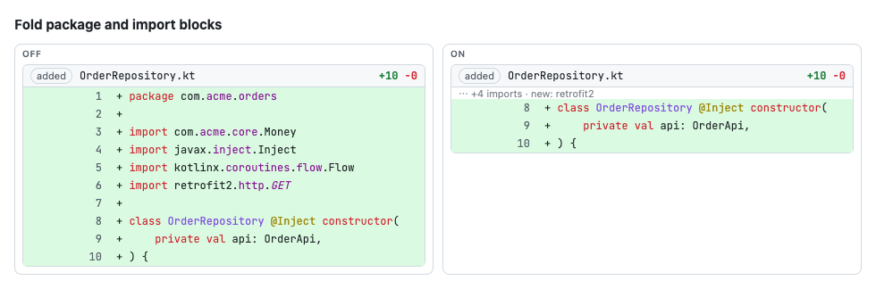
</picture>

## Install

With Homebrew, on macOS 13 or later:

```bash
brew tap bukuwarung/lgtm https://github.com/bukuwarung/lgtm
brew install --cask bukuwarung/lgtm/lgtm
gh auth login                                   # once, if you haven't
```

`brew upgrade` updates it. The app isn't notarized (there's no Apple Developer account behind it), so the cask clears macOS's download quarantine on install; you're trusting this repo's releases. Downloading `lgtm-X.Y.Z.zip` from [Releases](https://github.com/bukuwarung/lgtm/releases) by hand instead, macOS blocks the first launch: allow it in System Settings → Privacy & Security → Open Anyway.

Optional, for Slack messages and Jira tickets (lgtm never asks for a password or token: it uses these tools' sign-ins):

```bash
brew install shaharia-lab/tap/slackcli && slackcli auth login-auto
brew install atlassian/homebrew-acli/acli && acli jira auth login --web
```

If the org enforces SSO, authorize the gh token for it when GitHub asks. ⚙ Settings shows which sign-ins work and how to fix the rest.

## What it does

**Your queue.** Tabs for PRs to review, your own PRs, and a GitHub team you watch, grouped by where they stand. Each PR shows its size and what needs you: `CI failing`, `conflicts`, unsent comments, threads awaiting your reply, and `↻ re-review` when it's back on your plate. Refreshes every 3 minutes, with optional desktop notifications.

<picture>
  <source media="(prefers-color-scheme: dark)" srcset="docs/features/scene-queue-dark.png">
  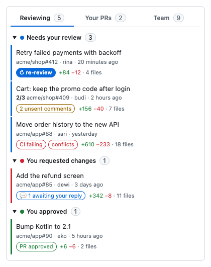
</picture>

**Reading.** Every changed file on one page, markdown first and tests right after their source. The Jira ticket and PR status on top, a jump index of comments, checks (with failed-job logs), threads and files, and navigation for stacked PRs. It reopens where you left off and marks files changed since your last visit. Syntax highlighting in your pick of code themes (IntelliJ, GitHub, VS Code, One, Dracula, Solarized, Gruvbox, Catppuccin, Tokyo Night, Nord) and free fonts (JetBrains Mono, Fira Code, Cascadia Code, Geist Mono, Iosevka and more), with code ligatures (`->` as →, `>=` as ≥) in the fonts that have them.

<picture>
  <source media="(prefers-color-scheme: dark)" srcset="docs/features/scene-review-dark.png">
  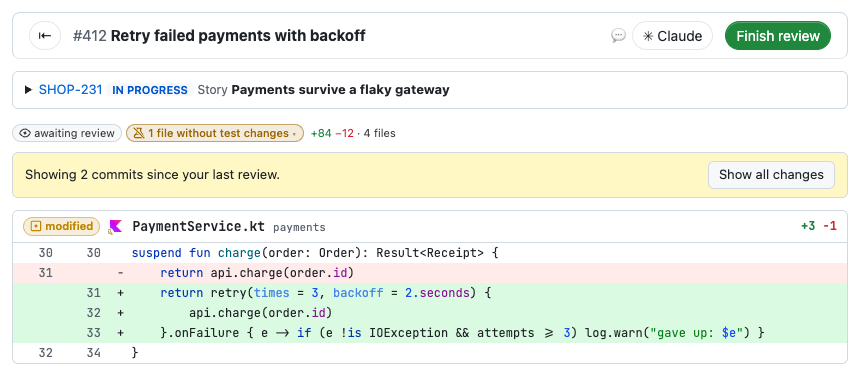
</picture>

**Commenting.** Line, range and file comments everywhere, rendered markdown included. An editor with preview, `:emoji:` and `@mention` completion, and suggested changes. Drafts survive reloads and go out as one review, with the verdict pre-picked from your comments; then lgtm opens the next PR that needs you. Optional Slack DM to the author, one thread per PR.

<picture>
  <source media="(prefers-color-scheme: dark)" srcset="docs/features/scene-comment-dark.png">
  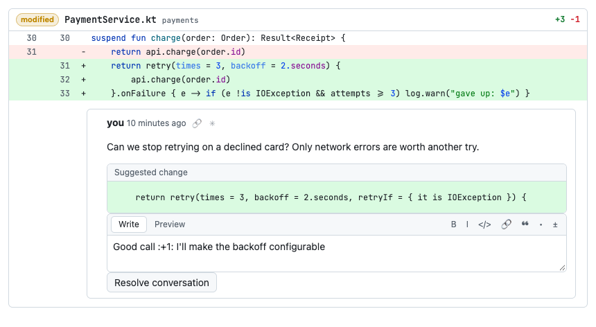
</picture>

**Claude Code.** ✳ Claude on the PR bar or on any comment opens a Claude Code session in the Claude desktop app with the PR or comment in the prompt (in the repo's local folder, set in Settings). Or it copies the prompt and reopens a session you already have: your last one, or one started on that PR (lgtm finds those in the Claude app's local session records; switch it off in Settings).

<picture>
  <source media="(prefers-color-scheme: dark)" srcset="docs/features/scene-claude-dark.png">
  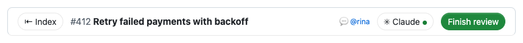
</picture>

**Your PRs.** A merge box with what's blocking and the controls: ready for review, update branch, merge, auto-merge. A PR waiting for review shows for how long, and after a day `🔔 nudge` reminds the requested reviewers on Slack (it asks before sending).

<picture>
  <source media="(prefers-color-scheme: dark)" srcset="docs/features/scene-merge-dark.png">
  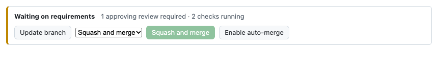
</picture>

**On your Mac.** A Dock badge with the "needs your review" count, notifications, `lgtm://<owner>/<repo>/pull/<n>` links, links opening in your browser, ⌘F across every file, Back and Forward (⌘[ ⌘]), a remembered window, and "Launch at login" in Settings. Copy a PR link anywhere (Slack, say) and switch to lgtm: it offers to open it. When a new version is out, the top bar says so. Help → Copy Diagnostics puts what a bug report needs on the clipboard (no tokens or PR text).

## Less to read

On by default, each with a switch (and these examples) in ⚙ Settings.

<details open><summary><b>Changes since your last review</b>: re-reviews start with only what changed since you last reviewed.</summary>

<picture>
  <source media="(prefers-color-scheme: dark)" srcset="docs/features/sinceFirst-dark.png">
  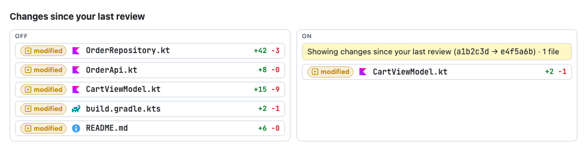
</picture>
</details>

<details open><summary><b>Fold imports</b>: package and import blocks fold to one line that names only new outside libraries.</summary>

<picture>
  <source media="(prefers-color-scheme: dark)" srcset="docs/features/foldImports-dark.png">
  
</picture>
</details>

<details open><summary><b>Hide generated files</b>: files marked <code>linguist-generated</code> wait behind one row.</summary>

<picture>
  <source media="(prefers-color-scheme: dark)" srcset="docs/features/hideGenerated-dark.png">
  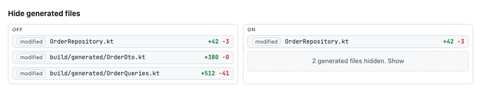
</picture>
</details>

<details open><summary><b>Hide moved files</b>: files renamed or moved without changes wait behind one row.</summary>

<picture>
  <source media="(prefers-color-scheme: dark)" srcset="docs/features/hideNoDiff-dark.png">
  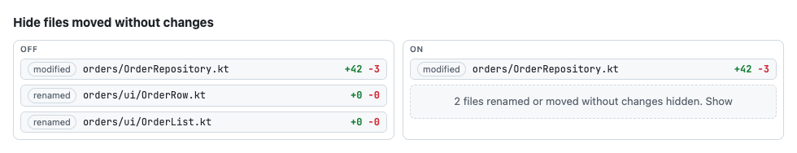
</picture>
</details>

<details open><summary><b>Collapse deleted files</b>: a deleted file is one row until you open it.</summary>

<picture>
  <source media="(prefers-color-scheme: dark)" srcset="docs/features/collapseDeleted-dark.png">
  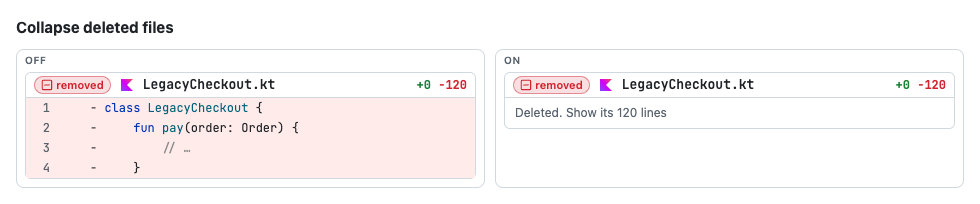
</picture>
</details>

<details open><summary><b>Dim moved code</b>: code moved without changes is dimmed, with where it came from.</summary>

<picture>
  <source media="(prefers-color-scheme: dark)" srcset="docs/features/dimMoved-dark.png">
  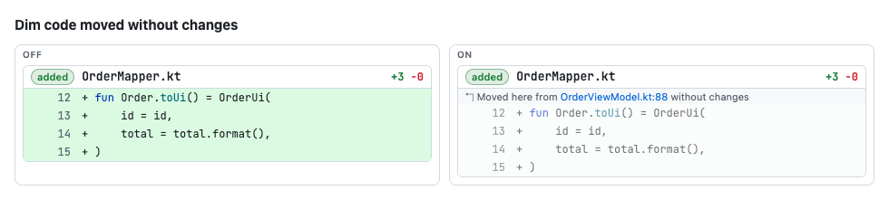
</picture>
</details>

<details open><summary><b>Word highlights</b>: the changed words inside a line stand out.</summary>

<picture>
  <source media="(prefers-color-scheme: dark)" srcset="docs/features/wordDiff-dark.png">
  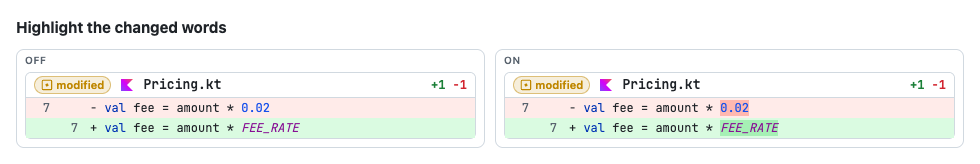
</picture>
</details>

<details open><summary><b>Ignore whitespace</b>: re-indented lines read as unchanged (<code>w</code>).</summary>

<picture>
  <source media="(prefers-color-scheme: dark)" srcset="docs/features/ignoreWs-dark.png">
  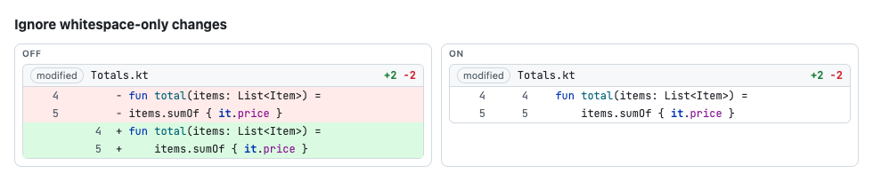
</picture>
</details>

<details open><summary><b>Rendered markdown</b>: markdown shows rendered, still commentable line by line.</summary>

<picture>
  <source media="(prefers-color-scheme: dark)" srcset="docs/features/richMarkdown-dark.png">
  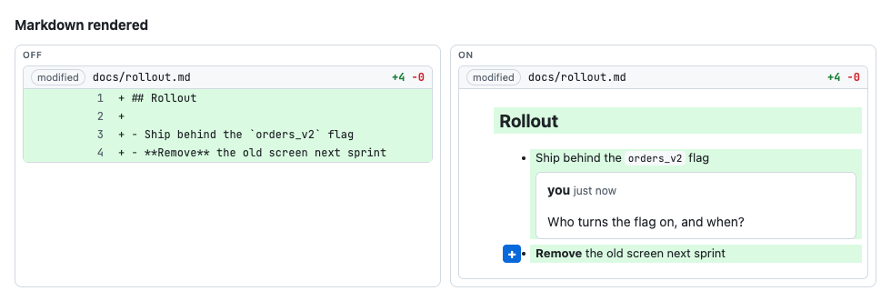
</picture>
</details>

<details open><summary><b>Rendered doc comments</b>: KDoc, Javadoc and JSDoc read like IntelliJ's reader mode; edited ones stay source.</summary>

<picture>
  <source media="(prefers-color-scheme: dark)" srcset="docs/features/renderDocs-dark.png">
  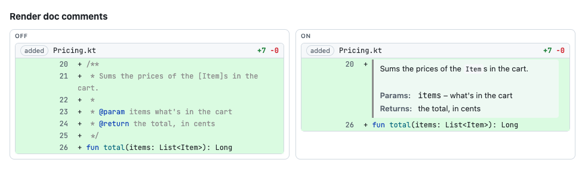
</picture>
</details>

<details open><summary><b>Image previews</b>: PNG, WebP, JPEG, GIF (Git LFS too) and Android vector drawables show as pictures.</summary>

<picture>
  <source media="(prefers-color-scheme: dark)" srcset="docs/features/previewImages-dark.png">
  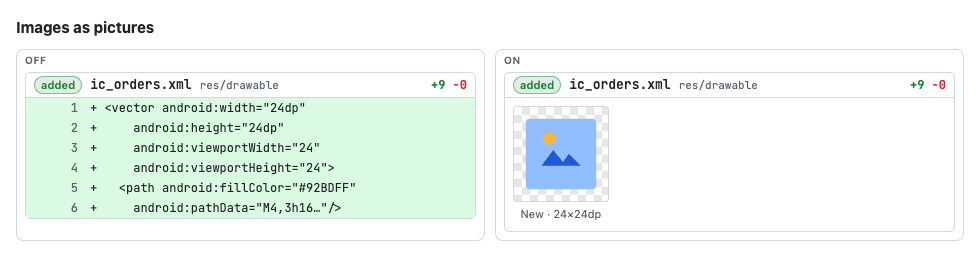
</picture>
</details>

<details open><summary><b>Fold bot comments</b>: CI and AI-reviewer comments fold to one line.</summary>

<picture>
  <source media="(prefers-color-scheme: dark)" srcset="docs/features/foldBots-dark.png">
  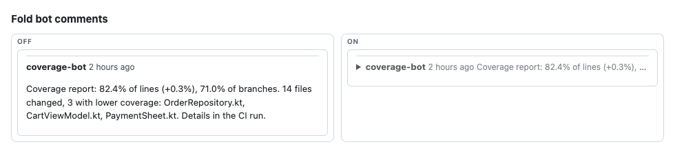
</picture>
</details>

## Keyboard shortcuts

The defaults; change the single-key ones in ⚙ Settings → Keyboard shortcuts.

| Key | Action |
|---|---|
| `j` / `k` | Next / previous file |
| `n` / `p` | Next / previous review thread |
| `Space` | Comment on the line under the mouse |
| `c` | Comment on the current file |
| `v` | Mark the current file viewed |
| `w` | Ignore whitespace on/off |
| `[` / `]` | Previous / next PR in the stack |
| `i` | Show / hide the index |
| `⌘↵` | Finish review |
| `⌘K` | Go to a PR, file, thread or check |
| `⌘F` | Find, in every file |
| `?` | All shortcuts |

## Slack people

lgtm messages people as you through slackcli, so it needs each GitHub account's Slack user. In ⚙ Settings → Slack people, "Find Slack accounts" looks them up (company email, then name, accepting only a single match) and you confirm each one. Mappings are saved in `~/.config/lgtm/config.json` (`{ "slackUsers": { "github-login": "U012ABC" } }`). Mark automation accounts as bots there so they're never messaged.

## Develop

`app/` is the UI (Preact) and a small Node server for the browser version; `desktop/` wraps the same UI in the Mac app with [Tauri](https://tauri.app) (plan: [`openspec/changes/add-desktop-app`](openspec/changes/add-desktop-app)).

```bash
cd app
npm test        # logic checks
npm start       # build, then run the browser version on port 4517
npm run demos   # recapture docs/features/*.png from src/demos.tsx (lgtm must be running)
```

To build the app you need Rust:

```bash
brew install rustup && rustup default stable
export PATH="/opt/homebrew/opt/rustup/bin:$PATH"   # rustup is keg-only
cd desktop && npm install && npm run build         # → src-tauri/target/release/bundle/macos/lgtm.app
```

`cargo test -- --ignored --nocapture` in `desktop/src-tauri` checks the app's commands against your real gh, slackcli and acli (read-only; Slack in dry run).

**Browser version.** The same review UI, served by Node 22+ and opened in your browser: `brew install bukuwarung/lgtm/lgtm-cli`, or from source `cd app && npm install && npm run build && npm link`. Then `lgtm`, or `lgtm https://github.com/owner/repo/pull/123` to open a PR. `LGTM_PORT` changes the port (drafts are stored per port), `LGTM_NO_OPEN=1` skips opening a tab, `LGTM_SLACK_DRY_RUN=1` checks Slack recipients without sending. Settings → Backup moves preferences and pending comments between it and the app. Design and specs: [`openspec/changes/add-pr-review-app`](openspec/changes/add-pr-review-app).

**Releasing.** On a Mac with Rust and both targets (`rustup target add aarch64-apple-darwin x86_64-apple-darwin`):

```bash
scripts/release.sh 0.2.0
```

It sets the version everywhere (Settings shows it), runs the tests, builds a universal, ad-hoc-signed `lgtm.app` and the browser version's tarball, and points [`Casks/lgtm.rb`](Casks/lgtm.rb) and [`Formula/lgtm-cli.rb`](Formula/lgtm-cli.rb) at them (version, SHA-256). Then it prints the two publishing commands: push the commit, and `gh release create` with both files. This repo is its own Homebrew tap, so `brew upgrade` picks the release up once both are out.

## License

[MIT](LICENSE)
